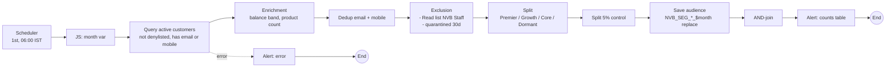
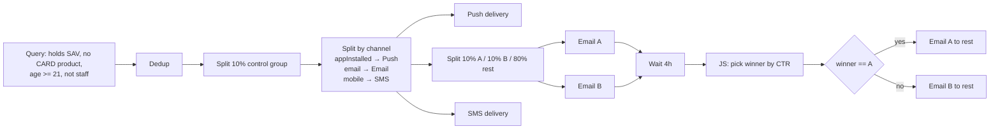
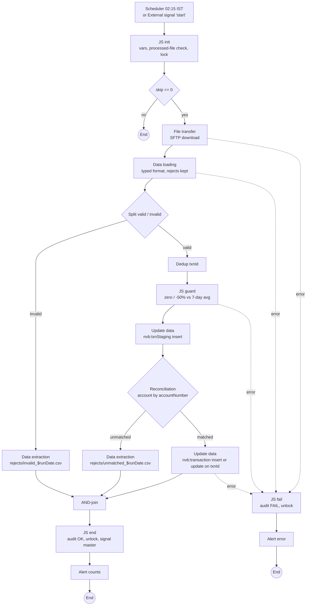
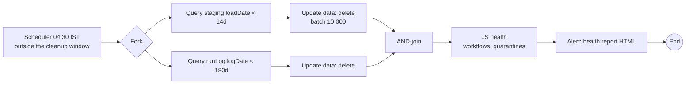
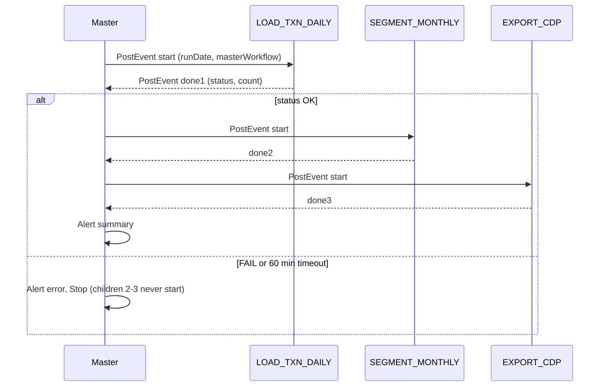
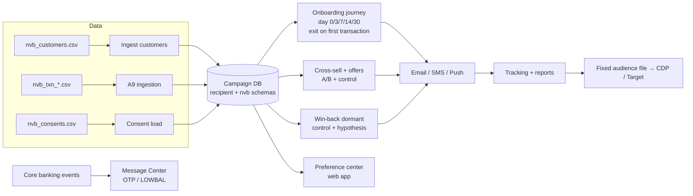

# NovaBank workflow designs

Build specifications for every workflow in the bootcamp. Each one lists its activities, their settings, and the expected counts when you use the files in `01-data`. The diagrams render on GitHub.

Naming: `NVB_<TW|CW|TPL|DRILL>_<SUBJECT>_<FREQUENCY>`. Folder: `NovaBank / Workflows` (internal name `nvbWorkflows`).

---

## A3: activity drills (D1–D10)

| Drill | Workflow | Activities and key settings | Expected result with bootcamp data |
|---|---|---|---|
| D1 | `NVB_DRILL_D1_QUERY` | Query on recipients: `city = Mumbai` and has a savings account (`accounts` exists with `type = SAV`). Additional data: `@ageBand = Iif(Age(@birthDate) < 30,'18-29',Iif(Age(@birthDate) < 45,'30-44','45+'))` | About 1 in 8 customers holding a savings account (Mumbai is 1 of 8 cities); new `ageBand` column |
| D2 | `NVB_DRILL_D2_INCR` | Scheduler (hourly) → Incremental query on recipients, created in the last 30 days | Run 1 returns N rows. Import one new customer, and run 2 returns 1 row |
| D3 | `NVB_DRILL_D3_SETS` | Query A (`loyaltyTier = GLD`), Query B (`appInstalled = 1`) → Union / Intersection / Exclusion, each on its own branch | \|A∪B\| = \|A\| + \|B\| − \|A∩B\| |
| D4 | `NVB_DRILL_D4_SPLIT` | Query → Split: subsets PLT / GLD / SLV plus complement; then a second Split with a 10% random control per subset | Subsets sum to the input; controls are about 10% |
| D5 | `NVB_DRILL_D5_DEDUP` | Data loading `nvb_dedup_drill.csv` (compute `Lower(email)`) → Deduplication on the lower-cased email, keep the most recent `updated_on` | Row count drops to 30 |
| D6 | `NVB_DRILL_D6_ENRICH` | Query → Enrichment: count of broadLogs in the last 30 days, max tracking log date | Two new columns |
| D7 | `NVB_DRILL_D7_CHDIM` | Query `nms:subscription` (service `nvbInsights`) → Change dimension to recipients, keeping one row per recipient | 60 rows |
| D8 | `NVB_DRILL_D8_LOAD` | File collector (`/in/nvb_products*.csv`) → Data loading → Reconciliation (`code`) → Update data (insert or update) into `nvb:product` | 8 inserts, then 0 inserts and 8 updates on the rerun |
| D9 | `NVB_DRILL_PARENT` / `NVB_DRILL_CHILD` | Parent JavaScript activity `PostEvent` → child External signal `signal` → Query using `$(instance/vars/@segment)` → Test on `vars.recCount > 0` | The child logs the segment; both Test branches are exercised |
| D10 | `NVB_DRILL_D10_EXPORT` | Query → Data extraction `/out/nvb_export_$(instance/vars/@runDate).csv` → File transfer (SFTP upload) → Alert with `vars.recCount` | A dated file arrives on the test SFTP |

---

## A4: `NVB_TPL_SEGMENT_MONTHLY`

| Segment | Filter (after enrichment) |
|---|---|
| Premier | `loyaltyTier = 'PLT'` OR max account balance ≥ 500,000 |
| Growth | `loyaltyTier = 'GLD'` OR product count ≥ 2 |
| Core | Active in the last 90 days (`lastLoginDate >= DaysAgo(90)`) |
| Dormant | Complement |

Reconciliation rule: target + control + excluded = query count.

---

## A5: `NVB_CW_CC_XSELL_2026Q4` (campaign workflow)

Typology `NVB_Marketing`: pressure 3 per 7 days (this campaign has weight 5), filtering (staff, age < 21), control rules from `07-scripts/typology_rules_A5.js`. Hypothesis: a card application (landing page form) within 14 days, compared with the control group.

---

## A9: `NVB_TW_LOAD_TXN_DAILY`

| Test file | Valid | Invalid | Unmatched | Transaction table effect |
|---|---|---|---|---|
| `nvb_txn_20260930.csv` | 1,000 | 0 | 0 | +1,000 inserts |
| same file again | — | — | — | skipped (run log) |
| `nvb_txn_20261001.csv` | 980 | 20 | 10 | +970 inserts |
| `nvb_txn_20261002.csv` | 100 | 0 | 0 | 50 updates + 50 inserts |
| `nvb_txn_20261003.csv` | 0 | 0 | 0 | guard alert, no writes |

The malformed amount and date rows may be rejected by Data loading itself (typed columns) rather than by the Split. Either way they must end up in a reject file, and you should document which step caught them.

---

## A10: `NVB_TW_HOUSEKEEPING`

---

## A11: `NVB_TW_MASTER_NIGHTLY`

`NVB_TW_EXPORT_CDP` writes the segment audience to one **fixed** file and table (`nvb_cdp_audience.csv` / `nvb:txnStaging`-style fixed schema). Never use a date-suffixed table name.

---

## Capstone: NovaBank Lifecycle Program

